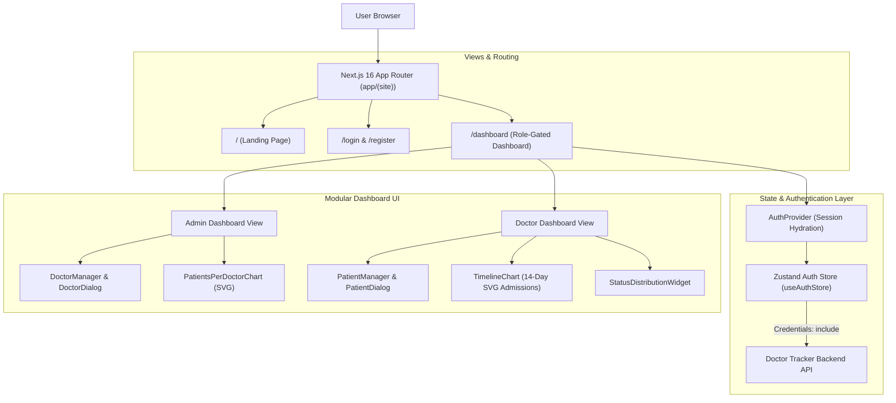
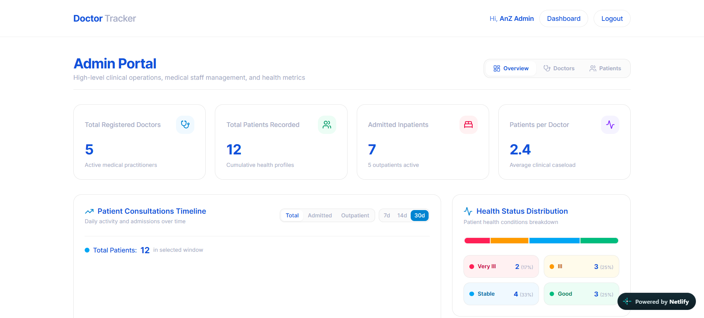
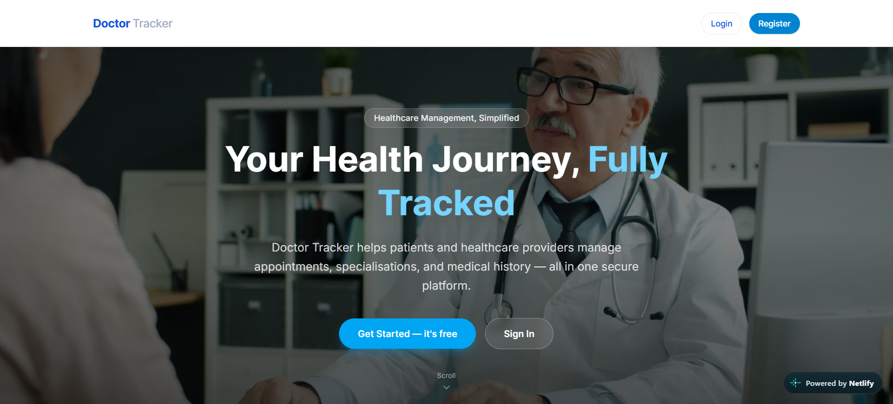
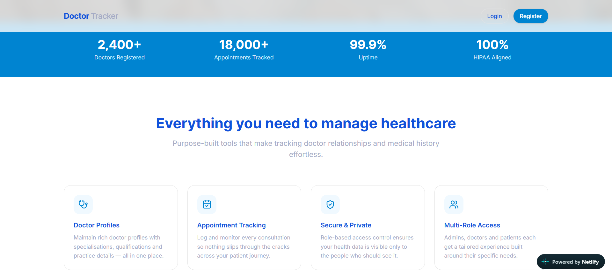
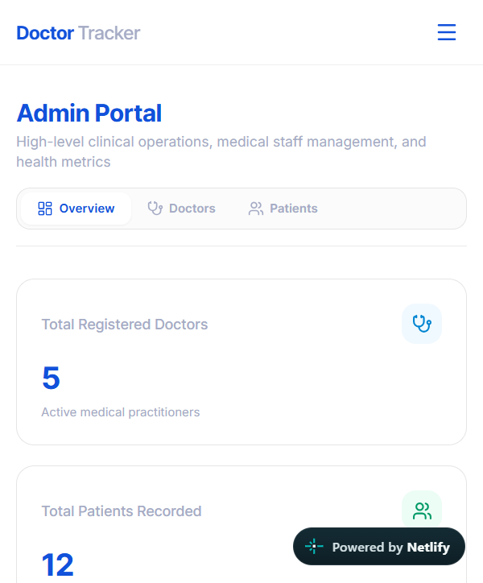
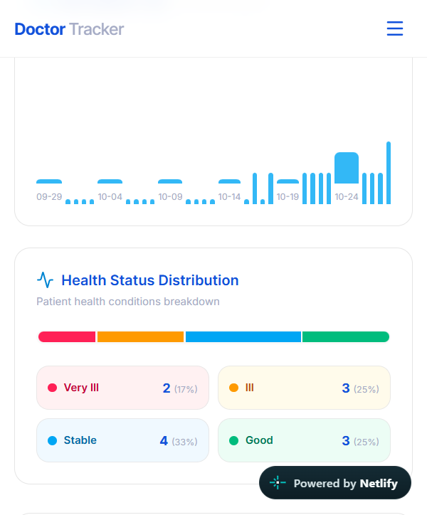
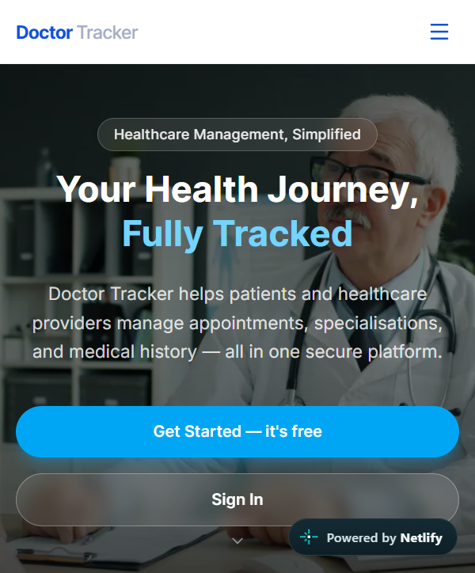

# Doctor Tracker Frontend

## Description
Doctor Tracker Frontend is a responsive, clinical-grade web application built with Next.js 16 (App Router), Tailwind CSS v4, and Zustand, designed to streamline patient caseload management and medical staff coordination for clinics and hospitals. The application delivers role-tailored dashboards for Administrators and Physicians featuring zero-dependency SVG data visualizations, live patient admission tracking, doctor workload distribution charts, and rapid triage workflows across all screen sizes.

---

## Setup Guide

Follow these step-by-step instructions to install, configure, and launch the frontend web client locally.

### 1. Prerequisites
- **Node.js**: v20.x or v22.x (v22.x LTS recommended)
- **pnpm**: v9.x or later (`npm install -g pnpm`)
- **Backend API**: The Doctor Tracker backend running locally or hosted (default: `http://localhost:4000/api`)

### 2. Installation
Navigate to the `frontend` directory and install project dependencies:
```bash
cd frontend
pnpm install
```

### 3. Environment Configuration
Create a `.env.local` file in the `frontend` root by copying the provided `.env.example`:
```bash
cp .env.example .env.local
```

#### `.env.example` Reference:
```env
NEXT_PUBLIC_API_URL=http://localhost:4000/api
```
> **Note**: For local development alongside the local backend, point `NEXT_PUBLIC_API_URL` to `http://localhost:4000/api`. In production, set this to your deployed API domain.

### 4. Running the Development Server
Start the Next.js development server with hot-module reloading:
```bash
pnpm dev
```
Open your browser and navigate to `http://localhost:3000`.

### 5. Production Build & Verification
Compile and verify the optimized production build:
```bash
pnpm build
pnpm start
```

---

## System Architecture

The frontend is structured around Next.js 16 App Router conventions, featuring a clean separation between route layouts, presentation components, state management stores, and HTTP communication layers.



### Component Architecture & Data Flow
1. **Session Hydration**: On application mount, `AuthProvider` queries `/api/auth/me` with `credentials: "include"` to hydrate `useAuthStore` with the authenticated user profile and role (`admin` or `doctor`).
2. **Role-Gated Routing**: The `/dashboard` route renders customized operational interfaces depending on the active role:
   - **Administrators**: Receive hospital-wide statistics, active doctor management modals, and cross-doctor caseload distribution analytics.
   - **Doctors**: Receive caseload timelines, status distribution widgets, and personal patient triage controls with automated self-assignment.
3. **Modular Dialogs**: Modals (`DoctorDialog`, `PatientDialog`) encapsulate form validation and mutation lifecycles without causing parent tree rerenders.

---

## Technical Decisions

### Decision 1: Zustand Store over Context API and Redux Toolkit
- **Context**: The application requires global state for the authenticated session, user role, and loading states accessible across navigation bars, route guards, and dashboard widgets.
- **Alternative Considered**: React Context API or Redux Toolkit.
- **Why We Chose Zustand**:
  - **Zero Unnecessary Re-renders**: Unlike React Context—which triggers re-renders across all consuming components whenever any piece of context updates—Zustand allows components to subscribe strictly to granular selectors (e.g., `useAuthStore(s => s.user?.role)`).
  - **Minimal Bundle Footprint**: Zustand adds under 2KB minified to the client bundle compared to Redux Toolkit (~40KB+), keeping initial page load near-instant.
  - **Clean Async Integration**: Actions like `fetchMe`, `setUser`, and `logout` are declared directly within the store without the complex boilerplate of Redux thunks or reducers.

### Decision 2: Custom SVG Visualizations over Heavy Charting Libraries (e.g. Chart.js / Recharts)
- **Context**: Dashboards display 14-day patient admission trends, condition distribution bars, and doctor caseload progress indicators.
- **Alternative Considered**: Integrating external charting libraries such as Recharts, Chart.js, or ApexCharts.
- **Why We Chose Custom SVG Visualizations**:
  - **Zero SSR Hydration Mismatches**: Heavy canvas/SVG charting libraries frequently cause React 19 / Next.js 16 SSR hydration mismatches due to dynamic DOM dimension calculations before client hydration.
  - **Zero Dependency Overhead**: Building accessible inline SVG charts (`TimelineChart`, `PatientsPerDoctorChart`, `StatusDistributionWidget`) reduced bundle size by over 200KB.
  - **Full Tailwind CSS v4 Theme Cohesion**: SVG elements dynamically adapt to responsive breakpoints (`w-full`, `viewBox`) and native Tailwind styling classes, maintaining smooth transitions and crisp rendering on both high-DPI retina screens and mobile viewports.

---

## Visual Evidence

### 1. Desktop & Wide Screen Views

#### Clinical Dashboard (Wide Screen)
High-level overview showing key metrics, 14-day admission timeline chart, status breakdown, and comprehensive patient directory.


#### Landing Page & Feature Showcase (Wide Screen)
Engaging marketing hero and workflow highlights explaining Doctor Tracker's capabilities.




---

### 2. Mobile & Responsive Small Screen Views

#### Mobile Dashboard Overview
Adaptive mobile layout optimizing metric cards, quick-action drawers, and patient lists for handheld devices.


#### Mobile Caseload & Health Status Breakdown
Responsive SVG charts and health status distribution indicators scaling seamlessly on smaller screens.


#### Mobile Landing Page
Clean, mobile-first responsive presentation of the landing page.

